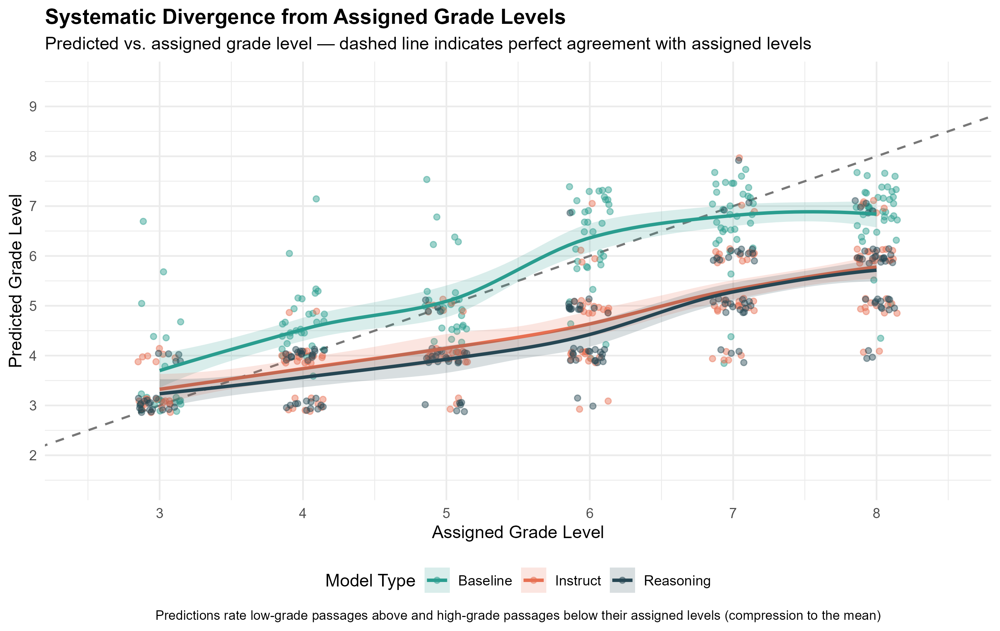
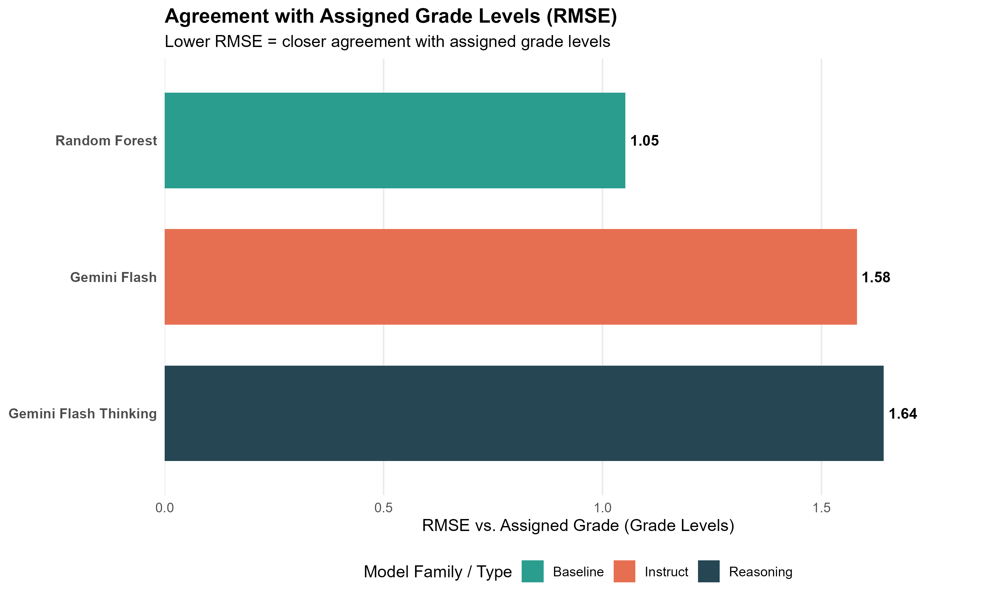
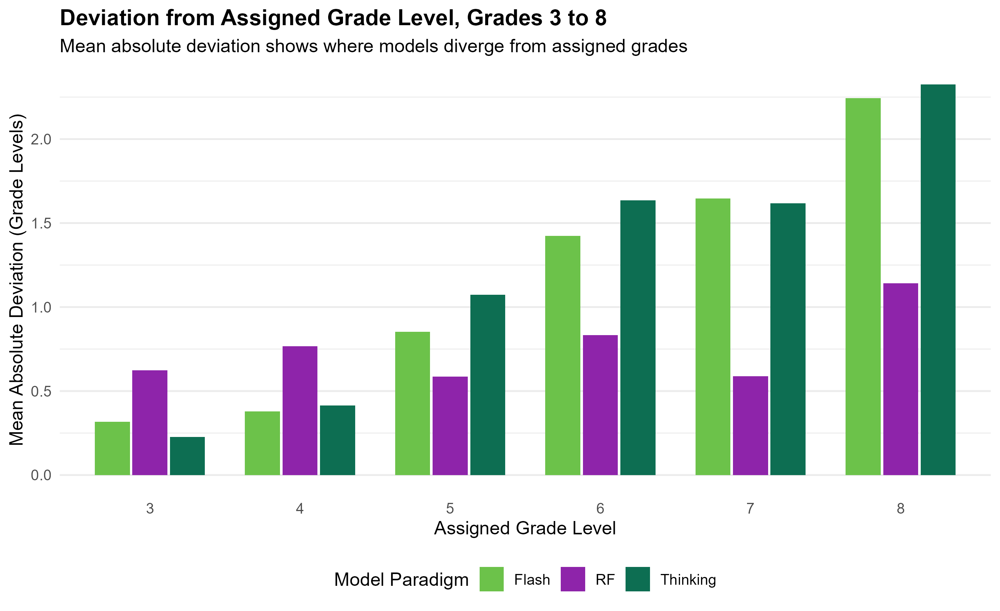

# Are New York State ELA Test Reading Passages Robust to LLM Scrutiny?

*By Howell Lu, Ruiting Shen, Thomas Szymanski*

For young New Yorkers, the New York State Test (NYST) is a substantial part of the grade 3-8 experience. Some students may realize much of their curriculum is painstakingly curated to prepare them for these assessments, yet many never grasp the full weight of their results. Annually, these scores are used to evaluate schools, districts, and, in some schools, individual teachers' performance evaluations. Given these high stakes, it is worth asking: how robust is the design of these tests, and do the passages actually reflect the grade-level complexity they're assigned to?

To address this, we conducted a case study of English Language Arts (ELA) reading passages, aiming to establish a parallel grade-level benchmark based on reading complexity. By comparing these parallel metrics against the official assigned levels, we could evaluate the robustness of the exams. Importantly, we do not treat the assigned grade level as absolute ground truth: a deviation between a model's estimate and the assigned level is not automatically a model mistake. Whether and where such deviations occur is precisely what we are studying. We therefore use "agreement" for how closely a method tracks the assigned levels; agreement with the assigned levels should not be confused with being a good reading-complexity model. We used Large Language Models (LLMs) as our primary analytical tool, supplemented by a machine-learning approach trained on traditional readability metrics to triangulate findings.

Traditional metrics like Flesch-Kincaid (sentence length/syllables), Dale-Chall (difficult word ratio), and Corrected Type-Token Ratio (CTTR; unique word ratio) provide benchmarks for reading complexity. We scored 182 released passages spanning 2019 and 2022-2026 (grades 3-8) using these metrics and fit a Random Forest on them. Because the predictions must be out-of-sample, we use out-of-bag (OOB) predictions averaged over repeated forests, so every passage is predicted by trees that never saw it. Random Forest handles non-linear relationships and correlated predictors well, allowing it to combine these overlapping readability metrics.

For LLM evaluation, we used a zero-shot, structured chain-of-thought prompt via a Python script, analyzing results in R (ggplot2 4.0.3). We tested two models through the Gemini API on all 182 passages: **Gemini 3.6 Flash** (a standard instruction-following model) and **Gemini 3.6 Thinking** (the same base model with extended reasoning enabled), with no parse errors in either run. This pairing lets us ask whether added reasoning improves grade-level estimates when the underlying model is held constant.

\
*Figure 1. The Random Forest and both Gemini models systematically diverge from assigned grade levels. The Random Forest overestimates lower grades and plateaus near grade 7, while the Gemini models compress toward the middle of the scale, topping out around grade 6 even for grade 8 passages.*

Figure 1 shows predicted grade level against assigned grade level, where the dashed diagonal line represents perfect agreement with the grade level each reading passage was tested under.

Both Gemini models deviated substantially from the assigned grade levels. They tracked grade 3 passages closely, modestly underestimated from grade 4 onward, and progressively underestimated more from grade 6 — plateauing around grade 6 even for passages assigned to grade 8. Their predictions are also restricted to whole grades, producing the horizontal bands visible in the plot. Gemini Flash and Gemini Thinking were nearly indistinguishable: extended reasoning did not change the shape of the pattern.

The Random Forest model came closer to preserving the direction of the grade-level scale. Its predictions generally increased as assigned grade level increased, signaling that traditional readability metrics were conducive to modest divergence with the assigned grade level. However, the model also showed a compression pattern: it tended to overestimate lower-grade passages and flatten out for higher-grade passages. It overestimated grade 3-5 passages to a greater extent than the Gemini models, but it underestimated the upper grades to a far lesser extent.

\
*Figure 2. RMSE against assigned grade levels by model. Random Forest agrees most closely with the assigned levels (1.05), followed by Gemini Flash (1.58) and Gemini Flash Thinking (1.64).*

The overall RMSE comparison quantifies the pattern observed in Figure 1. Random Forest had the lowest RMSE (1.05), meaning it converged most closely to the assigned grade levels. Gemini Flash followed at 1.58, and Gemini Flash Thinking diverged slightly more at 1.64. A lower RMSE here indicates closer agreement with the assigned levels, not necessarily a better judgment of complexity. Thinking mode used roughly three times the latency per passage and tens of thousands of additional reasoning tokens without moving the models any closer to the assigned levels.

\
*Figure 3. Mean absolute deviation from the assigned grade, by assigned grade. The Gemini models agree more closely with the assigned levels than the Random Forest on grades 3-4, but their deviation grows steadily with grade level, reaching over 2 grade levels at grade 8, while the Random Forest stays between roughly 0.6 and 1.1.*

Breaking deviation down by assigned grade shows where the methods part ways with the assigned levels. The Gemini models sit closer to the assigned levels than the Random Forest on the lowest grades (mean absolute deviation of roughly 0.2-0.4 vs. 0.6-0.8 for grades 3-4), but their deviation rises nearly monotonically with grade, to about 2.3 for grade 8 passages. The Random Forest's deviation is much flatter across grades. This is the compression pattern in numerical form: the LLMs are anchored to a narrow band of grade levels and diverge increasingly from the assigned levels as they rise. Whether that reflects the models' limits or passages that are not as complex as their assigned grades suggest is the open question.

Across all three methods, predicted grade levels diverged systematically from assigned grade levels — a compression toward the middle of the scale that intensified for higher-grade passages. This pattern is consistent with regression to the mean: when a model lacks a strong signal to distinguish grade levels, predictions gravitate toward the center of the distribution. Admittedly, part of the gap also reflects what readability metrics and LLMs cannot see, such as knowledge demands. For the LLM results specifically, prompt sensitivity is a meaningful limitation: the zero-shot chain-of-thought prompt used here is one of many possible approaches, and an optimized prompt may have yielded meaningfully different grade-level estimates. Nonetheless, the consistency of the divergence — even from a Random Forest evaluated out-of-bag on held-out passages — suggests that the quantitative complexity signal in NYST ELA passages does not cleanly stratify by grade. This is worth examining further given the stakes attached to the test.

*Source data: <https://www.nysedregents.org/ei/ei-ela.html>*
